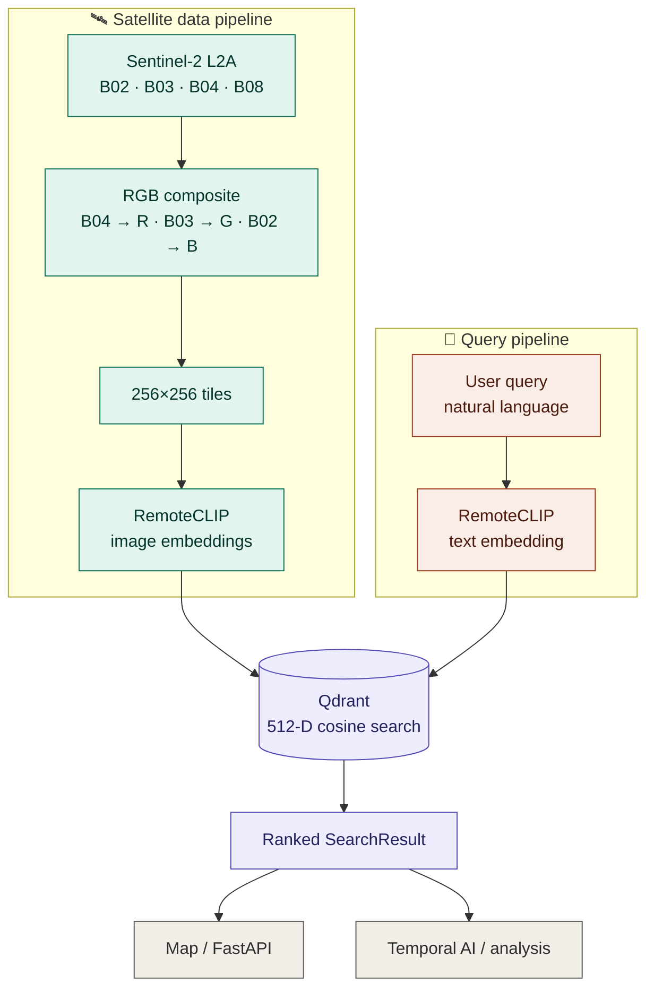
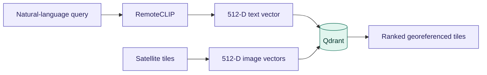
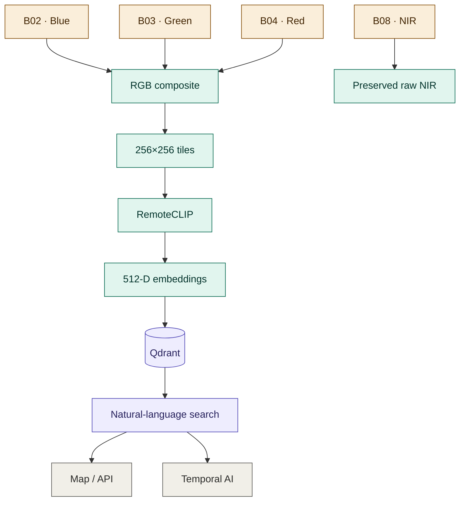

<div align="center">

# 🛰️ TriNetraAI

### Semantic Retrieval + Multi-Temporal Change Analysis for Satellite Imagery

*Find what matters in satellite imagery — by meaning, location, and time.*

[](https://www.python.org/)
[](https://pytorch.org/)
[](https://qdrant.tech/)
[](#)
[](#)
[](#)

</div>

---

## 🌍 What is TriNetraAI?

**TriNetraAI** is an on-premises satellite-imagery system that lets analysts search georeferenced tiles using **natural language** — no bounding-box scripts, no manual tile-hunting.

```text
"buildings near a river"
"dense urban area"
"vegetation"
"green area near water"
```

Under the hood, a shared text/image embedding space (**RemoteCLIP**) and a local vector database (**Qdrant**) turn these queries into ranked, map-ready results — built on top of raw **Sentinel-2** multispectral data with full geospatial provenance.

> ⚠️ **Note:** Semantic retrieval is a *ranking* system, not proof of an exact object or spatial relationship. Pair it with the temporal/change-analysis module for stronger verification.

---

## ✨ Key Features

| Feature | What it does |
|---|---|
| 🔎 **Natural-language search** | Query satellite imagery with free text |
| 🧠 **RemoteCLIP embeddings** | Shared text/image representation tuned for remote sensing |
| 📦 **Qdrant vector search** | 512-D cosine-similarity retrieval |
| 🗺️ **Geographic filtering** | Restrict search to a lat/lon bounding box |
| 📅 **Multi-date imagery** | Independent processing per acquisition date |
| 🌈 **Multispectral preservation** | Keeps Sentinel-2 B02 / B03 / B04 / B08 source bands |
| 🎨 **RGB generation** | Builds RemoteCLIP-ready RGB tiles from B04/B03/B02 |
| 🧭 **Geospatial provenance** | Preserves CRS, bounds, transform, acquisition date |
| 💻 **CPU-friendly inference** | Runs locally — no GPU required |
| 🐍 **Clean Python API** | `search()` → typed `SearchResult` objects |
| 📊 **Evaluation tooling** | Ground truth, retrieval metrics, robustness, benchmarks |

---

## 🏗️ Architecture



### 🔬 Semantic AI Pipeline



---

## 🧰 Main Technologies

| Tech | Role |
|---|---|
| **RemoteCLIP (ViT-B/32)** | Remote-sensing vision-language embeddings |
| **Qdrant** | Vector database, cosine similarity |
| **Rasterio** | GeoTIFF I/O, geospatial metadata, tiling |
| **Pillow** | RGB image handling |
| **PyTorch** | Model inference |
| **Python 3.10+** | Runtime |

---

## 📁 Project Structure

```
TriNetraAI/
├── data/
│   ├── raw/sentinel2/         # Local raw Sentinel-2 bands
│   ├── tiles/sentinel2/       # Generated RGB tiles
│   ├── embeddings/            # Generated embedding files
│   └── evaluation/            # Ground truth & evaluation outputs
│
├── docs/
│   └── semantic_ai_integration.md
│
├── models/
│   └── remoteclip/            # RemoteCLIP checkpoint location
│
├── scripts/
│   ├── generate_embeddings.py
│   ├── index_embeddings.py
│   ├── process_sentinel2.py
│   ├── search.py
│   ├── evaluate.py
│   ├── evaluate_metrics.py
│   ├── evaluate_ensemble.py
│   ├── evaluate_robustness.py
│   ├── benchmark_search.py
│   └── validate_production_readiness.py
│
├── semantic_search/
│   ├── embeddings.py
│   ├── evaluation.py
│   ├── ground_truth.py
│   ├── metrics.py
│   ├── model.py
│   ├── query_expansion.py
│   ├── schemas.py
│   ├── search.py
│   ├── sentinel2.py
│   └── vector_store.py
│
├── tests/
├── requirements.txt
└── README.md
```

---

## 🚀 Setup

### 1️⃣ Clone the repository

```bash
git clone https://github.com/itsPJ0204/TriNetraAI.git
cd TriNetraAI
git checkout master   # Semantic AI work lives on master
```

### 2️⃣ Create a virtual environment

<details>
<summary><strong>Windows / PowerShell</strong></summary>

```powershell
python -m venv venv
.\venv\Scripts\Activate.ps1
```
</details>

<details>
<summary><strong>Linux / macOS</strong></summary>

```bash
python3 -m venv venv
source venv/bin/activate
```
</details>

### 3️⃣ Install dependencies

```bash
pip install -r requirements.txt
```

### 4️⃣ Add the RemoteCLIP checkpoint

Download the official RemoteCLIP **ViT-B/32** checkpoint and place it at:

```
models/remoteclip/RemoteCLIP-ViT-B-32.pt
```

> Model weights are intentionally excluded from Git.

---

## 🗄️ Qdrant

Start a local Qdrant instance with Docker:

```bash
docker run -d \
  -p 6333:6333 \
  -p 6334:6334 \
  -v qdrant_storage:/qdrant/storage \
  --name qdrant \
  qdrant/qdrant
```

Dashboard → **http://localhost:6333/dashboard**

| Collection | `satellite_tiles` |
|---|---|
| Vector size | 512 |
| Distance | Cosine |

---

## 🛰️ Sentinel-2 Data Workflow

Raw multispectral data is kept separate from the RGB tiles used by RemoteCLIP — one folder per acquisition date.

```
data/raw/sentinel2/
├── 2025-06-07/
│   ├── B02.tiff
│   ├── B03.tiff
│   ├── B04.tiff
│   └── B08.tiff
├── 2026-01-18/
│   └── ...
└── 2026-06-27/
    └── ...
```

### Band mapping

| Band | Channel |
|---|---|
| B02 | Blue |
| B03 | Green |
| B04 | Red |
| B08 | Near Infrared (NIR) — preserved, not mixed into RGB |

**RemoteCLIP RGB composite:** `B04 → Red`, `B03 → Green`, `B02 → Blue`

> B08 stays available in its raw form for future vegetation / spectral analysis.

### ➕ Adding a new acquisition date

No code changes needed — just drop in a new date folder with all four bands:

```
data/raw/sentinel2/2027-03-10/
├── B02.tiff
├── B03.tiff
├── B04.tiff
└── B08.tiff
```

The processor auto-discovers valid date directories. Before processing, confirm all four bands share the same **dimensions, CRS, bounds, and spatial transform**, and contain valid pixel data.

### 🖼️ Generate RGB images & tiles

The pipeline automatically:

- Discovers all valid date folders
- Builds an RGB composite from B04/B03/B02
- Keeps B08 unchanged in raw storage
- Applies deterministic percentile normalization
- Creates 256×256 tiles (edge tiles kept, not discarded)
- Preserves geospatial information

```bash
python -c "from semantic_search.sentinel2 import process_all_sentinel2_dates; r=process_all_sentinel2_dates(); print({k: len(v) for k,v in r.items()})"
```

Output:

```
data/tiles/sentinel2/
├── 2025-06-07/
│   ├── sentinel2_rgb_full.tif
│   ├── sentinel2_tile_1.tif
│   └── ...
└── ...
```

> Exact tile count depends on source image dimensions; edge tiles may be smaller than 256×256.

---

## 🧬 Embeddings & Indexing

### Generate RemoteCLIP embeddings

```bash
python -m scripts.generate_embeddings
```

Recursively discovers RGB tiles inside date folders and produces:

```
data/embeddings/
├── image_embeddings.npy
└── image_paths.json
```

Each embedding: **512-D · float32 · L2 normalized**

### Index into Qdrant

```bash
python -m scripts.index_embeddings
```

Stores each vector with metadata: `tile_name`, `image_path`, `date`, `CRS`, `bounds`, `width`, `height`, provenance, band mapping.

> **Current workflow:** the embedding file is a generated batch manifest. The long-term goal is incremental indexing — existing vectors stay in Qdrant, only newly added tiles get embedded and upserted.

---

## 🔍 Search

### CLI

```bash
python -m scripts.search "buildings near a river"
python -m scripts.search "vegetation"
python -m scripts.search "dense urban area"
python -m scripts.search "green area near water"
python -m scripts.search "roads through green areas"
```

**Geographic filter** (`left bottom right top`):

```bash
python -m scripts.search "urban area" --bbox 77.20 28.58 77.25 28.64
```

### Python API

```python
from semantic_search import search, SearchResult

results: list[SearchResult] = search(
    "buildings near a river",
    top_k=5,
)

for result in results:
    print(result.tile_name)
    print(result.score)
    print(result.date)
    print(result.bounds)
```

**With a bounding box:**

```python
from semantic_search import search

bbox = {"left": 77.20, "bottom": 28.58, "right": 77.25, "top": 28.64}

results = search("urban area near water", bbox=bbox, top_k=5)
```

---

## 📦 `SearchResult`

| Field | Type | Purpose |
|---|---|---|
| `tile_name` | `str` | Tile identifier |
| `image_path` | `str` | Local tile path |
| `score` | `float` | Cosine similarity score |
| `crs` | `str` | Coordinate reference system |
| `bounds` | `dict` | Geographic extent — left/bottom/right/top |
| `width` | `int` | Tile width |
| `height` | `int` | Tile height |
| `date` | `str` | Acquisition date |

`bounds` can be fed directly into a Leaflet/OpenLayers-style frontend to draw or highlight the tile on a map.

```json
{
  "tile_name": "sentinel2_tile_4.tif",
  "score": 0.317259,
  "crs": "EPSG:4326",
  "bounds": {
    "left": 77.22598,
    "bottom": 28.64355,
    "right": 77.24898,
    "top": 28.66374
  },
  "date": "2026-06-27"
}
```

For API responses:

```python
json_results = [result.to_dict() for result in results]
```

---

## 🔗 Team Integration

The Semantic AI module is designed to be consumed by the application layer **without exposing Qdrant internals**.

```
User query → Semantic AI → search() → SearchResult[] → FastAPI / Frontend
```

```python
from semantic_search import search

results = search("buildings near a river", top_k=5)

response = {
    "query": "buildings near a river",
    "count": len(results),
    "results": [r.to_dict() for r in results],
}
```

**Map integration:** `search() → SearchResult → bounds → map rectangle / highlighted area`

**Temporal AI integration:**

```
User query → Semantic AI → Relevant candidate tiles → Temporal / Change AI → Before vs After → Verified change
```

Semantic retrieval and temporal change detection stay as **separate, composable modules**.

---

## 🧪 Evaluation

| Command | Purpose |
|---|---|
| `python -m scripts.evaluate_metrics` | Retrieval metrics |
| `python -m scripts.evaluate_ensemble` | Prompt ensemble experiment |
| `python -m scripts.evaluate_robustness` | Search robustness |
| `python -m scripts.benchmark_search` | CPU performance benchmark |
| `python -m scripts.validate_production_readiness` | Production/readiness audit |

Reports are stored under `data/evaluation/`.

---

## ✅ Testing

```bash
python -m pytest                                  # full suite
python -m pytest tests/test_integration_contract.py  # single module
```

---

## 🗃️ Data & Git Notes

Excluded from Git (large / generated artifacts):

```
venv/
*.pt
*.pth
*.ckpt
*.safetensors
*.tif
*.tiff
data/embeddings/
index/qdrant_storage/
```

Keep locally or in shared team storage:

```
data/raw/sentinel2/
data/tiles/sentinel2/
models/remoteclip/
```

> 🚫 Do not force-push shared branches.

---

## 🔄 Current Semantic AI Flow



---

## 📝 Notes

- Semantic search is intended for **retrieval and ranking**, not exact object detection.
- Complex spatial phrases (*near*, *through*, *surrounded by*) may need downstream verification.
- Multiple acquisition dates are stored separately to retain spatial and temporal provenance.
- New Sentinel-2 dates can be added by creating a new date folder — no date-specific code edits required.

---

<div align="center">

**TriNetraAI** — three-eyed vision for satellite intelligence 👁️‍🗨️

</div>